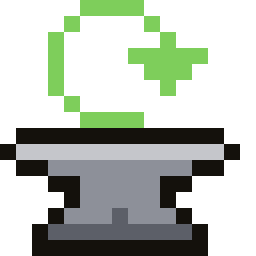
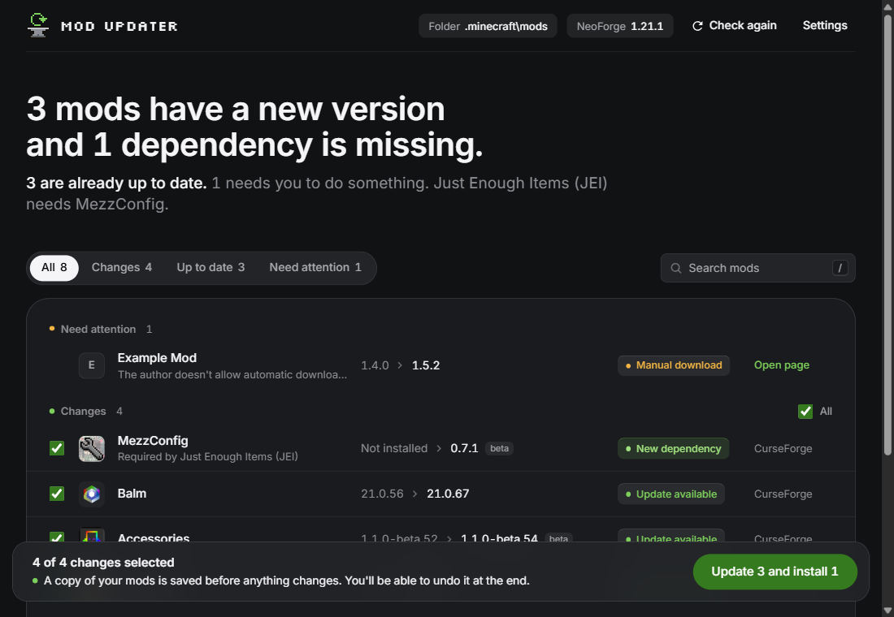
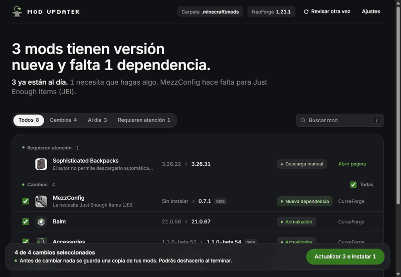
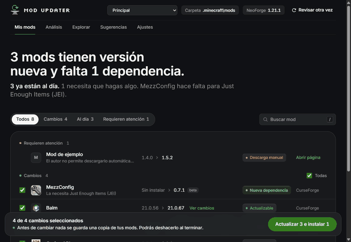
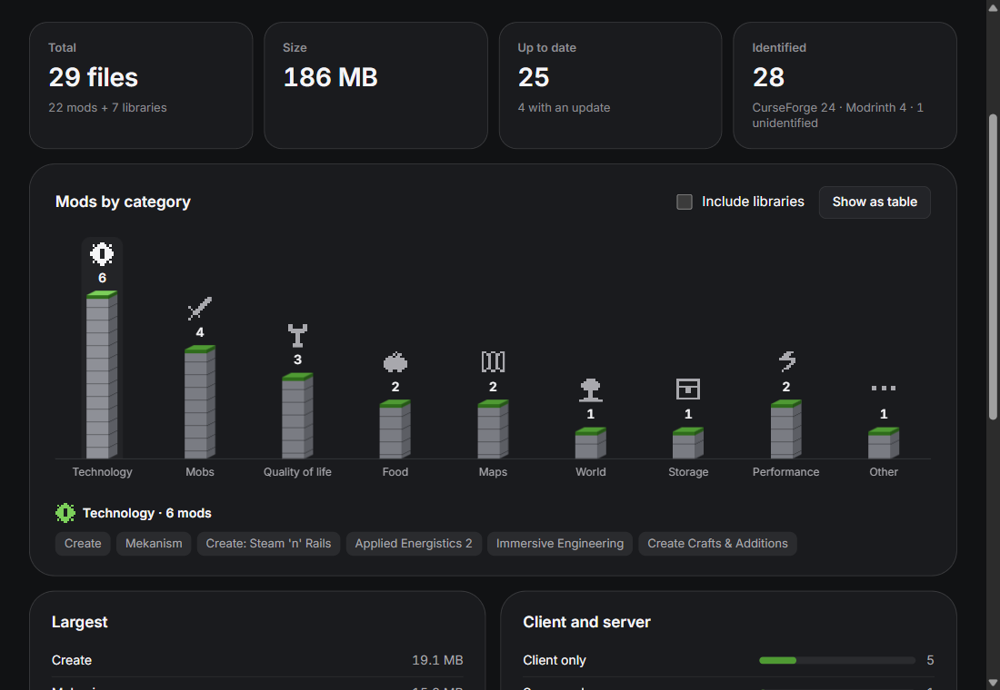
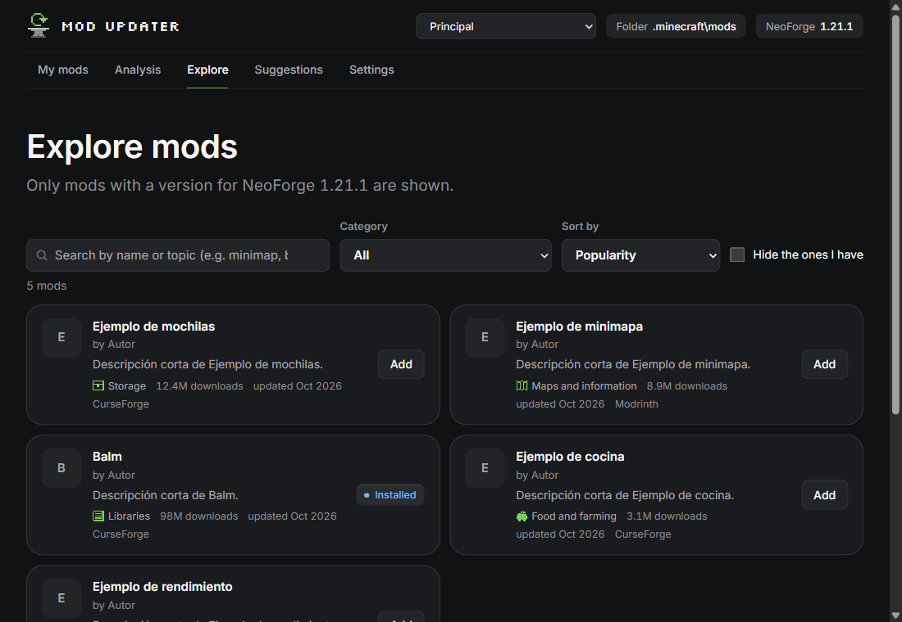
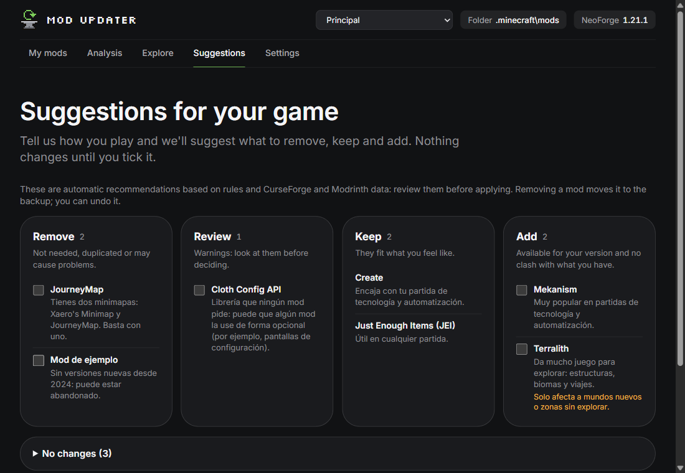

<p align="center">
  
</p>

<h1 align="center">Mod Updater</h1>

<p align="center">
  Update your Minecraft mods in one click, with a backup and an undo button.
</p>

<p align="center">
  <a href="https://github.com/racsoga/mod_updater_Minecraft/actions/workflows/tests.yml"></a>
  <a href="LICENSE"></a>
  
</p>

<p align="center"><a href="README.md">Español</a> · <b>English</b></p>

<p align="center">
  
</p>

## What it does

Mod Updater checks your Minecraft `mods` folder, recognises each mod by its fingerprint on **CurseForge** and **Modrinth**, and tells you which ones have a new version. You choose what to update.

- **Recognises your mods even if you renamed the files**: it identifies them by their content, not their name.
- **Respects your game version and mod loader**: it only suggests versions for your Minecraft (e.g. 1.21.1) and your loader, which it works out from your own mods. Designed for NeoForge, Forge, Fabric and Quilt; tested with NeoForge 1.21.1.
- **Installs missing dependencies**: if a mod needs another one you don't have, it adds it and tells you why ("Just Enough Items needs MezzConfig").
- **Doesn't break your game**: if a dependency can't be downloaded, that mod isn't updated. If you have a mod's stable version, it won't suggest betas (unless you enable them).
- **There's always a way back**: a copy of your mods is saved before anything changes. When it finishes you can **Undo**.
- **Never touches anything while Minecraft is open.**
- In **English and Spanish** (it follows your Windows language).
- **Collection analysis**: mods by category, what takes the most space, mods not updated or possibly abandoned, and libraries no mod uses.
- **Explore and install new mods**: search CurseForge and Modrinth at once, only what exists for your version, and install them with their dependencies.
- **Profiles**: several folders or instances (official launcher, CurseForge, Prism, MultiMC, Modrinth App), each with its own version and loader.
- **Share your mod list**: export and import the list (or a `.mrpack`) so someone else gets exactly the same mods.
- **Suggestions for your game**: what to remove, review, keep and add based on how you play, always with the reason.
- **Enable and disable mods** without deleting them (they become `.jar.disabled`, as in Prism, CurseForge and Modrinth App), one by one or several at once. If you disable a library other mods use, it warns you.
- **Pin a mod's version** so it isn't updated (with a reason, e.g. "the server uses this one") and **go back to an earlier version** if the new one causes problems.
- **Crash diagnosis**: reads Minecraft's crash report on your PC and tells you which mod to suspect, with the line that shows it and a button to fix it (install what's missing, swap an incompatible mod, disable, or go back to an earlier version).
- **Find the mod that breaks your game by halves**, when the diagnosis isn't clear: you just open Minecraft and say whether it still fails.
- **See the changes before updating**: the notes of every version between yours and the new one, highlighting possible world-breaking changes.

<p align="center">
  
</p>

### Analysis, Explore and Suggestions

<p align="center">
  
</p>

<table>
  <tr>
    <td></td>
    <td></td>
    <td></td>
  </tr>
</table>

## Download

1. Download [**ModUpdater.exe**](https://github.com/racsoga/mod_updater_Minecraft/releases/latest/download/ModUpdater.exe) (latest version; also under [*Releases*](https://github.com/racsoga/mod_updater_Minecraft/releases/latest), with the notes and the SHA-256).
2. Open it. Nothing to install. If Windows shows a warning, see [right below](#if-windows-warns-you-when-opening-it).

> **Make a copy of your `mods` folder the first time.** The app keeps backups and lets you undo, but your own copy never hurts.

**Requirements:** 64-bit Windows 10 or 11, an internet connection and Microsoft's WebView2 component (included in Windows 11 and in up-to-date Windows 10).

### If Windows warns you when opening it

- **SmartScreen** ("Windows protected your PC"): press **More info → Run anyway**.
- **Microsoft Defender blocks it or quarantines it**: open *Windows Security → Virus & threat protection → Protection history*, expand the `ModUpdater.exe` entry and choose **Actions → Allow on device**. Then download it again if it was deleted.

**Why it happens:** it's a `.exe` built with Python (PyInstaller) and **not digitally signed** (the certificate costs money). Windows doesn't know it yet, and some antivirus engines confuse it with malicious programs packaged the same way. It's a false positive: version 0.3.0 is flagged by 3 of VirusTotal's 68 engines (Bkav, SecureAge and Microsoft, with a generic machine-learning detection, `Wacatac.C!ml`) ([see report](https://www.virustotal.com/gui/file/0ef3739ed7676be34873107f1c2f580e76e542784049a0a194e38406e40201db)).

**[Code signing policy](CODE_SIGNING_POLICY.md):** an application to SignPath Foundation for a free open-source certificate is in progress; until it is approved, the `.exe` is not signed.

**Check it yourself:** your file's SHA-256 must match the one in the Release (see *How do I check the .exe is the original?* in the [FAQ](#faq)), and each Release's notes link to the VirusTotal scan of that exact file. The full source code is in this repository.

## First run

1. **Mods folder.** The app suggests `%APPDATA%\.minecraft\mods`. If you use another launcher (CurseForge, Prism, Modrinth App…), press *Change folder* and pick your instance's `mods` folder.
2. **Version and mod loader.** They're detected from your mods; check they're right.
3. **CurseForge key** (optional, but recommended). Without it only Modrinth is checked and some mods may show as *Not found*. See [how to get one](#how-to-get-a-curseforge-key).
4. Press **Check my mods**, tick what you want and press **Update**.

## How to get a CurseForge key

CurseForge requires each person to use **their own key** (it can't be shared or bundled with the app).

1. Go to [console.curseforge.com](https://console.curseforge.com/) and sign in (or create an account).
2. If asked, create an organisation with any name.
3. Open the **API Keys** section and copy your key.
4. In Mod Updater, paste it into *CurseForge key* and press **Test**. If it says "Valid key", you're done.

## FAQ

<details>
<summary><b>Windows says "Windows protected your PC" (SmartScreen). Is it dangerous?</b></summary>

It appears because the executable isn't signed with a paid certificate, not because anything was detected. Press **More info → Run anyway**. If you'd rather check first, see *How do I check the .exe is the original?* below; the full source code is in this repository.
</details>

<details>
<summary><b>My antivirus says the <code>.exe</code> is suspicious</b></summary>

It's a **false positive**. It happens to many programs built with PyInstaller, because from the outside they resemble others that really are malicious. Version 0.3.0 is flagged by 3 of VirusTotal's 68 engines: Bkav, SecureAge and Microsoft Defender (generic detection `Wacatac.C!ml`) ([see report](https://www.virustotal.com/gui/file/0ef3739ed7676be34873107f1c2f580e76e542784049a0a194e38406e40201db)). If Defender blocks it, see [If Windows warns you when opening it](#if-windows-warns-you-when-opening-it).

- Each Release's notes link to the **VirusTotal scan** of the exact file, so you can see for yourself.
- Check your file is the original (see the next question).
- If your antivirus blocks it, download **`ModUpdater-…-carpeta.zip`** from the same Release. It's the same program as a folder: unzip it and open the `ModUpdater.exe` inside.
</details>

<details>
<summary><b>How do I check the <code>.exe</code> is the original?</b></summary>

Every Release includes the **SHA-256** of each file, in the notes and in `ModUpdater.exe.sha256`. It's a unique fingerprint: changing a single byte of the file would give a different one.

1. Open PowerShell in the folder where you downloaded the file.
2. Run:
   ```powershell
   Get-FileHash .\ModUpdater.exe -Algorithm SHA256
   ```
3. The `Hash` value must match the one in the Release (upper or lower case doesn't matter). If it doesn't match, don't open it and download it again from this repository's *Releases* page.
</details>

<details>
<summary><b>Where is my key stored? Is it safe?</b></summary>

- It's stored in **Windows Credential Manager**, not in a file.
- It's never shown in full: only the last 4 characters.
- It's only sent to CurseForge's servers (`api.curseforge.com` and its download CDN). No other site receives it, even if a download redirects elsewhere.
- It never appears in logs or error messages.
- You can delete it at any time from *Settings → Delete key*.
</details>

<details>
<summary><b>What if an update breaks something?</b></summary>

Press **Undo** on the final screen, or *Settings → Undo the last update*. The old files go back to the `mods` folder and the new ones are set aside (not deleted) in `.minecraft\mods_backup\<date>\undo`. Each backup has a `cambios.txt` that explains what changed.
</details>

<details>
<summary><b>A mod shows as "Up to date", but the website has a newer version.</b></summary>

If the newer version is a **beta** and you have the stable one, the app doesn't suggest it and tells you "A newer beta is available". To have betas suggested, enable them in *Settings*.
</details>

<details>
<summary><b>What does "Manual download" mean? And "Not found"?</b></summary>

- **Manual download:** there's a new version, but the author doesn't allow other apps to download it. Press *Open page* and download it from the website.
- **Not found:** the file isn't on CurseForge or Modrinth (your own mod, or downloaded elsewhere). It's left as is.
</details>

<details>
<summary><b>Does it work with Forge, Fabric or other Minecraft versions?</b></summary>

It's designed for NeoForge, Forge, Fabric and Quilt, and for any Minecraft version that has mods on CurseForge or Modrinth: choose the version and loader in *Settings*. But **it has only been tested with NeoForge 1.21.1**. Other combinations should work, but there may be bugs; if you find one, [let us know](https://github.com/racsoga/mod_updater_Minecraft/issues/new/choose).
</details>

<details>
<summary><b>Can I use it with several instances or launchers?</b></summary>

Yes, with **profiles**. Each profile is a `mods` folder with its own Minecraft version and loader. In *Settings → Profiles* you can look for instances of the official launcher, CurseForge, Prism, MultiMC and Modrinth App, or add a folder by hand. Switch profiles with the selector at the top. Each profile keeps its own settings and its *Suggestions* answers.
</details>

<details>
<summary><b>How do I give my mod list to a friend?</b></summary>

In *Settings → Share the mod list*:

- **Export list…** saves a `.modlist.json` file with the mods and the exact version of each one. It contains no paths, no key and no personal data.
- Your friend presses **Import list…**: they see what will be added, what changes version and what isn't available before anything is installed. Optionally they can remove the mods that aren't in the list (they're moved to the backup, not deleted).
- **Export .mrpack…** creates a Modrinth pack that opens in Prism or Modrinth App (only with the mods that are on Modrinth).
- **Copy list** copies names and versions as text, to paste in a chat.
</details>

<details>
<summary><b>How do Suggestions work? Will it delete my mods?</b></summary>

Nothing changes until you tick it and confirm. You answer a few questions (what you feel like playing, difficulty, whether you play alone or with others, how your PC runs and how many mods you want at most) and the app sorts your mods into **Remove**, **Review**, **Keep** and **Add**, always with the reason:

- **Remove:** duplicated mods (for example, two minimaps), known incompatibilities or mods that don't fit how you play. It never suggests removing a library or a mod another one needs.
- **Review:** notices for you to decide (mods with no new versions for a long time, libraries no mod asks for, mods that change difficulty a lot).
- **Add:** popular mods that exist for your version and don't clash with the ones you have.

These are automatic rules based on CurseForge and Modrinth data, not expert advice: review them. Removing a mod moves it to the backup and can be **undone**.
</details>

## Privacy

- **No telemetry or analytics.** The app doesn't send usage data to anyone.
- To identify your mods it sends CurseForge and Modrinth the **fingerprint** (hash) of each `.jar` file, not the file or your data.
- It only connects to `api.curseforge.com`, `api.modrinth.com` and their download and image servers (`forgecdn.net`, `modrinth.com`).
- Also, at most once a day it checks `api.github.com` for a new version of Mod Updater (nothing of yours is sent). Turn it off in *Settings → Tell me when there's a new version of Mod Updater*.
- What it stores stays on your PC: settings in `%APPDATA%\mod_updater`, the key in Credential Manager and backups in `.minecraft\mods_backup`.

## Disclaimer

Mod Updater is an **unofficial** personal project. It is not affiliated with, sponsored or endorsed by Mojang Studios, Microsoft, CurseForge (Overwolf) or Modrinth. *Minecraft* is a trademark of Mojang Studios and Microsoft. Mods belong to their authors; the app only downloads them from the official sources.

## For developers

<details>
<summary>Run from source, command line, tests and build</summary>

```bat
python -m venv .venv
.venv\Scripts\python -m pip install -r requirements.txt -r requirements-dev.txt

.venv\Scripts\python -m mod_updater.gui        :: the app (or double-click ModUpdater.pyw)
.venv\Scripts\python -m mod_updater            :: CLI: checks without changing anything
.venv\Scripts\python -m mod_updater --apply    :: CLI: updates (asks for confirmation)
.venv\Scripts\python -m pytest                 :: tests
.venv\Scripts\python -m PyInstaller packaging\ModUpdater.spec --noconfirm --distpath build/dist --workpath build/work
```

During development the key can go in a `.env` file (`CF_API_KEY=…`, see `.env.example`); it's in `.gitignore`.

**Releasing a version:** update `CHANGELOG.md` and `mod_updater/__init__.py`, then create a `vX.Y.Z` tag. GitHub Actions runs the tests, builds `ModUpdater.exe` with the icon and creates the Release with the changelog notes.

Structure and technical decisions (in Spanish): [`docs/PLAN.md`](docs/PLAN.md) and [`docs/PLAN_v2.md`](docs/PLAN_v2.md).
</details>

## License

[MIT](LICENSE) © 2026 Oscar Gonzalez
