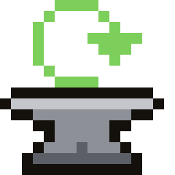
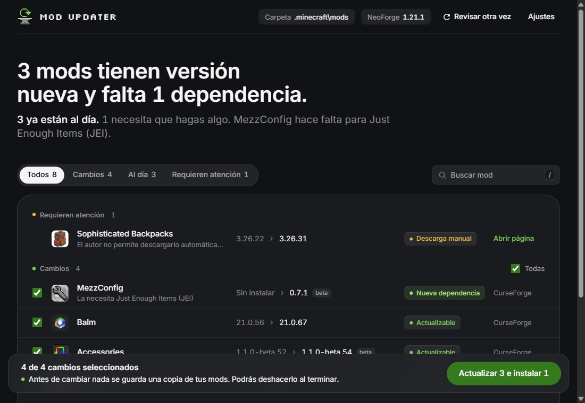
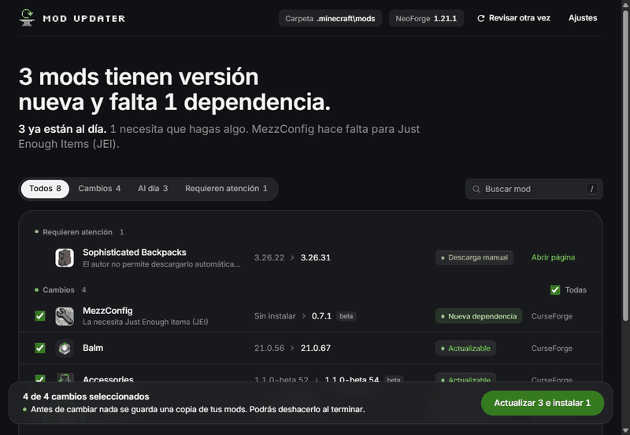
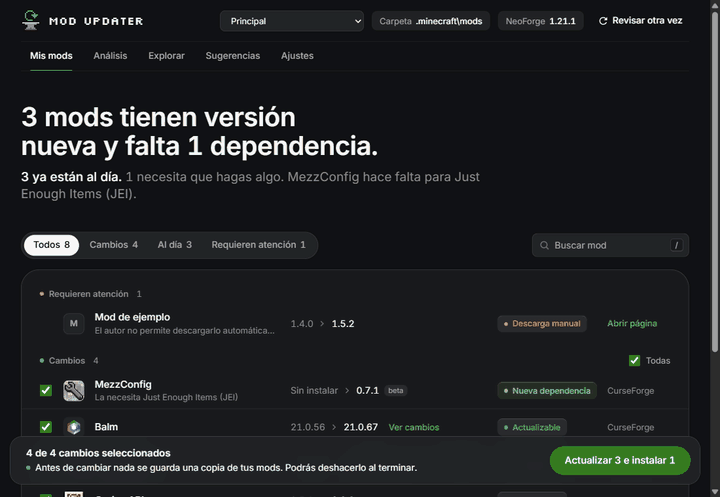
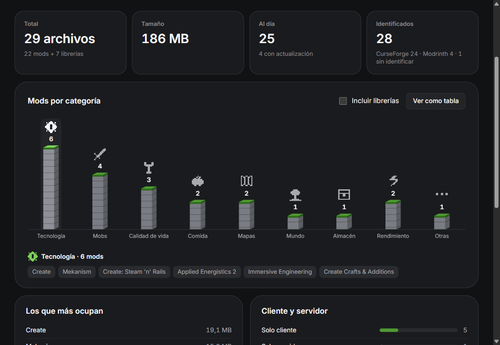
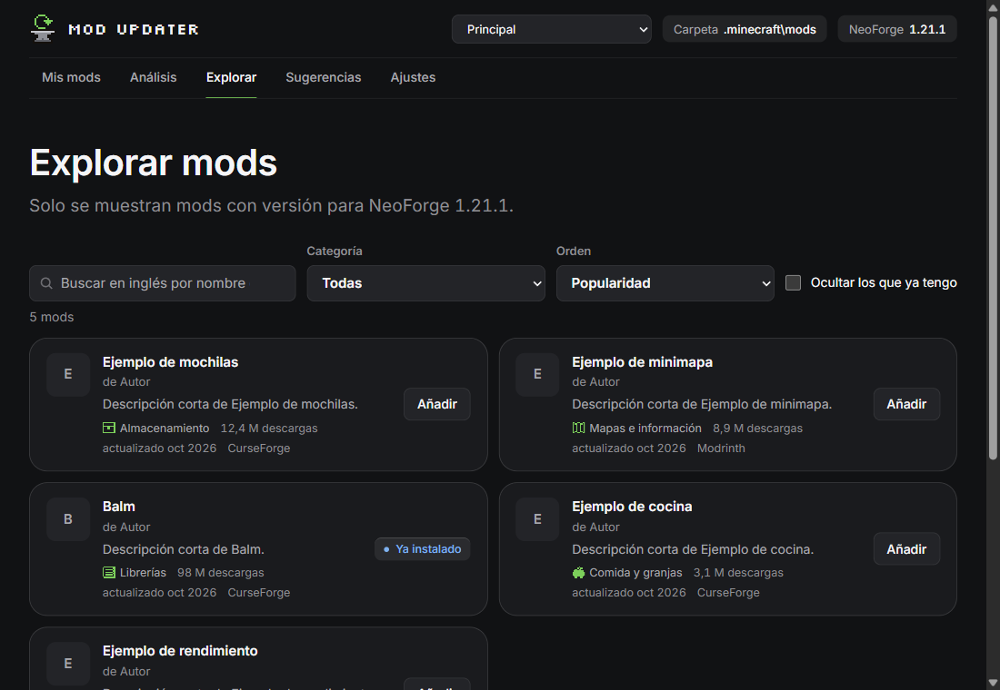
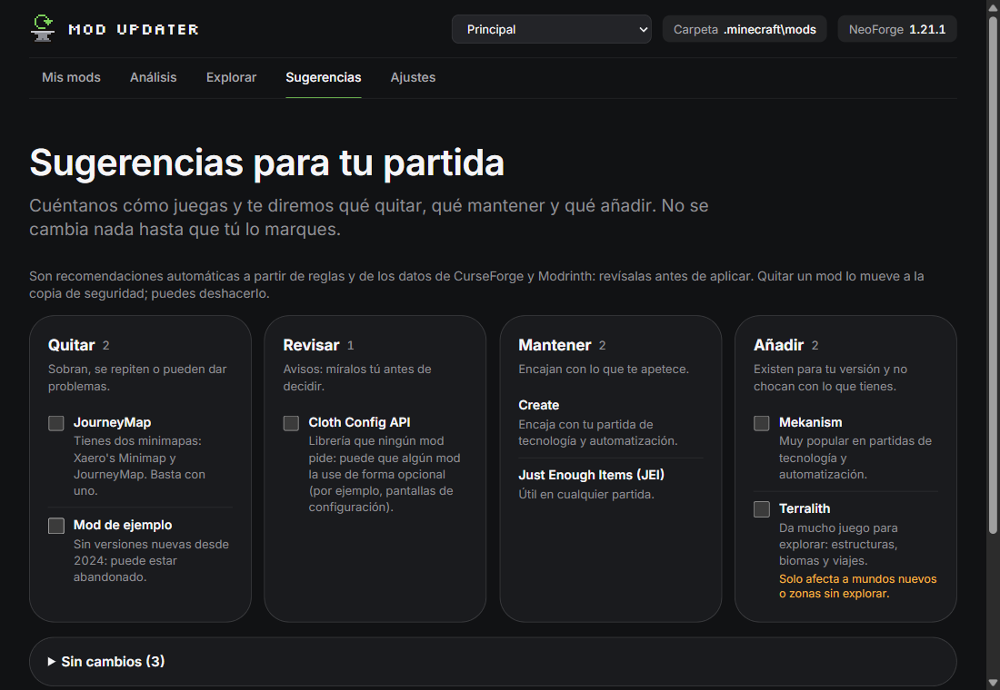

<p align="center">
  
</p>

<h1 align="center">Mod Updater</h1>

<p align="center">
  Actualiza los mods de tu Minecraft en un clic, con copia de seguridad y botón de deshacer.
</p>

<p align="center">
  <a href="https://github.com/racsoga/mod_updater_Minecraft/actions/workflows/tests.yml"></a>
  <a href="LICENSE"></a>
  
</p>

<p align="center"><b>Español</b> · <a href="README.en.md">English</a></p>

<p align="center">
  
</p>

## Qué hace

Mod Updater revisa la carpeta `mods` de tu Minecraft, reconoce cada mod por su huella en **CurseForge** y **Modrinth**, y te dice cuáles tienen versión nueva. Tú eliges qué actualizar.

- **Reconoce tus mods aunque hayas renombrado los archivos**: los identifica por su contenido, no por el nombre.
- **Respeta tu versión y tu cargador de mods**: solo propone versiones para tu Minecraft (por ejemplo 1.21.1) y tu cargador, que deduce de tus propios mods. Pensado para NeoForge, Forge, Fabric y Quilt; probado con NeoForge 1.21.1.
- **Instala las dependencias que faltan**: si un mod necesita otro que no tienes, lo añade y te dice por qué ("MezzConfig hace falta para Just Enough Items").
- **No rompe tu partida**: si una dependencia no se puede descargar, ese mod no se actualiza. Si tienes la versión estable de un mod, no te propone betas (salvo que lo actives).
- **Siempre hay vuelta atrás**: antes de cambiar nada guarda una copia de tus mods. Al terminar puedes **Deshacer**.
- **No toca nada con Minecraft abierto.**
- En **español e inglés** (usa el idioma de Windows).
- **Análisis de tu colección**: mods por categoría, lo que más ocupa, mods sin actualizar o posiblemente abandonados y librerías que ningún mod usa.
- **Explorar e instalar mods nuevos**: busca en CurseForge y Modrinth a la vez, solo lo que existe para tu versión, y los instala con sus dependencias.
- **Perfiles**: varias carpetas o instancias (launcher oficial, CurseForge, Prism, MultiMC, Modrinth App), cada una con su versión y cargador.
- **Compartir tu lista de mods**: exporta e importa la lista (o un `.mrpack`) para que otra persona tenga exactamente los mismos mods.
- **Sugerencias para tu partida**: qué quitar, revisar, mantener y añadir según cómo juegas, siempre con el motivo.
- **Activar y desactivar mods** sin borrarlos (pasan a `.jar.disabled`, como en Prism, CurseForge y Modrinth App), uno a uno o varios a la vez. Si desactivas una librería que usan otros mods, te avisa.
- **Fijar la versión** de un mod para que no se actualice (con un motivo, por ejemplo "el servidor usa esta") y **volver a una versión anterior** si la nueva da problemas.
- **Diagnóstico de crasheos**: lee el informe de error de Minecraft en tu PC y te dice qué mod sospechar, con la línea que lo demuestra y un botón para arreglarlo (instalar lo que falta, cambiar un mod incompatible, desactivar o volver a una versión anterior).
- **Buscar el mod que rompe la partida por mitades**, si el diagnóstico no lo deja claro: tú solo abres Minecraft y dices si sigue fallando.
- **Ver los cambios antes de actualizar**: las notas de todas las versiones entre la tuya y la nueva, con avisos de posibles cambios que rompen partidas.

<p align="center">
  
</p>

### Análisis, Explorar y Sugerencias

<p align="center">
  
</p>

<table>
  <tr>
    <td></td>
    <td></td>
    <td></td>
  </tr>
</table>

## Descarga

1. Descarga [**ModUpdater.exe**](https://github.com/racsoga/mod_updater_Minecraft/releases/latest/download/ModUpdater.exe) (última versión; también en [*Releases*](https://github.com/racsoga/mod_updater_Minecraft/releases/latest), con las notas y el SHA-256).
2. Ábrelo. No hace falta instalar nada. Si Windows avisa, mira [justo debajo](#si-windows-avisa-al-abrirlo).

> **Haz una copia de tu carpeta `mods` la primera vez.** La app guarda copias de seguridad y permite deshacer, pero una copia tuya nunca está de más.

**Requisitos:** Windows 10 u 11 de 64 bits, conexión a internet y el componente WebView2 de Microsoft (viene con Windows 11 y con Windows 10 actualizado).

### Si Windows avisa al abrirlo

- **SmartScreen** ("Windows protegió tu PC"): pulsa **Más información → Ejecutar de todas formas**.
- **Microsoft Defender lo bloquea o lo pone en cuarentena**: abre *Seguridad de Windows → Protección antivirus y contra amenazas → Historial de protección*, despliega el aviso de `ModUpdater.exe` y elige **Acciones → Permitir en el dispositivo**. Luego vuelve a descargarlo si se borró.

**Por qué pasa:** es un `.exe` hecho con Python (PyInstaller) y **sin firma digital** (el certificado es de pago). Windows no lo conoce todavía y algunos antivirus lo confunden con programas maliciosos empaquetados igual. Es un falso positivo: la versión 0.3.0 la marcan 3 de 68 antivirus de VirusTotal (Bkav, SecureAge y Microsoft, con una detección genérica por aprendizaje automático, `Wacatac.C!ml`) ([ver informe](https://www.virustotal.com/gui/file/0ef3739ed7676be34873107f1c2f580e76e542784049a0a194e38406e40201db)).

**Política de firma de código** ([Code signing policy](CODE_SIGNING_POLICY.md)): está en curso la solicitud a SignPath Foundation de un certificado gratuito para proyectos de código abierto; hasta que lo aprueben, el `.exe` no está firmado.

**Cómo comprobarlo tú:** el SHA-256 de tu archivo debe coincidir con el de la Release (ver *¿Cómo compruebo que el .exe es el original?* en [Preguntas frecuentes](#preguntas-frecuentes)), y las notas de cada Release enlazan al análisis de VirusTotal de ese archivo exacto. El código fuente completo está en este repositorio.

## Primer uso

1. **Carpeta de mods.** La app propone `%APPDATA%\.minecraft\mods`. Si usas otro launcher (CurseForge, Prism, Modrinth App…), pulsa *Cambiar carpeta* y elige la carpeta `mods` de tu instancia.
2. **Versión y cargador de mods.** Se deducen de tus mods; revisa que sean correctos.
3. **Key de CurseForge** (opcional, pero recomendada). Sin ella solo se consulta Modrinth y algunos mods pueden salir como *No encontrado*. Ver [cómo conseguirla](#cómo-conseguir-la-key-de-curseforge).
4. Pulsa **Revisar mis mods**, marca lo que quieras y pulsa **Actualizar**.

## Cómo conseguir la key de CurseForge

CurseForge exige que cada persona use **su propia key** (no se puede compartir ni incluir en la app).

1. Entra en [console.curseforge.com](https://console.curseforge.com/) e inicia sesión (o crea una cuenta).
2. Si te lo pide, crea una organización con cualquier nombre.
3. Abre la sección **API Keys** y copia tu key.
4. En Mod Updater, pégala en *Key de CurseForge* y pulsa **Probar**. Si sale "Key válida", ya está.

## Preguntas frecuentes

<details>
<summary><b>Windows dice "Windows protegió tu PC" (SmartScreen). ¿Es peligroso?</b></summary>

Sale porque el ejecutable no está firmado con un certificado de pago, no porque se haya detectado nada. Pulsa **Más información → Ejecutar de todas formas**. Si prefieres comprobarlo antes, mira más abajo *¿Cómo compruebo que el .exe es el original?*; el código fuente completo está en este repositorio.
</details>

<details>
<summary><b>Mi antivirus dice que el <code>.exe</code> es sospechoso</b></summary>

Es un **falso positivo**. Les pasa a muchos programas hechos con PyInstaller, porque se parecen por fuera a otros que sí son maliciosos. La versión 0.3.0 la marcan 3 de 68 antivirus de VirusTotal: Bkav, SecureAge y Microsoft Defender (detección genérica `Wacatac.C!ml`) ([ver informe](https://www.virustotal.com/gui/file/0ef3739ed7676be34873107f1c2f580e76e542784049a0a194e38406e40201db)). Si Defender lo bloquea, mira [Si Windows avisa al abrirlo](#si-windows-avisa-al-abrirlo).

- Las notas de cada Release enlazan al **análisis de VirusTotal** del archivo exacto, para que lo veas tú.
- Comprueba que tu archivo es el original (ver la siguiente pregunta).
- Si tu antivirus lo bloquea, descarga **`ModUpdater-…-carpeta.zip`** de la misma Release. Es el mismo programa en carpeta: descomprímelo y abre `ModUpdater.exe` de dentro.
</details>

<details>
<summary><b>¿Cómo compruebo que el <code>.exe</code> es el original?</b></summary>

Cada Release incluye el **SHA-256** de cada archivo, en las notas y en `ModUpdater.exe.sha256`. Es una huella única: si alguien cambiara un solo byte del archivo, saldría otra.

1. Abre PowerShell en la carpeta donde descargaste el archivo.
2. Ejecuta:
   ```powershell
   Get-FileHash .\ModUpdater.exe -Algorithm SHA256
   ```
3. El valor de `Hash` debe ser igual al de la Release (da igual que esté en mayúsculas o minúsculas). Si no coincide, no lo abras y vuelve a descargarlo de la página de *Releases* de este repositorio.
</details>

<details>
<summary><b>¿Dónde se guarda mi key? ¿Es seguro?</b></summary>

- Se guarda en el **Administrador de credenciales de Windows**, no en un archivo.
- Nunca se muestra entera: solo los últimos 4 caracteres.
- Solo se envía a los servidores de CurseForge (`api.curseforge.com` y su CDN de descargas). Ningún otro sitio la recibe, ni siquiera si una descarga redirige a otro servidor.
- No aparece en registros ni mensajes de error.
- Puedes borrarla en cualquier momento desde *Ajustes → Borrar key*.
</details>

<details>
<summary><b>¿Y si una actualización rompe algo?</b></summary>

Pulsa **Deshacer** en la pantalla final, o *Ajustes → Deshacer la última actualización*. Los archivos viejos vuelven a la carpeta `mods` y los nuevos se apartan (no se borran) en `.minecraft\mods_backup\<fecha>\undo`. En cada copia hay un `cambios.txt` que explica qué cambió.
</details>

<details>
<summary><b>Un mod sale "Al día", pero en la web hay una versión más nueva.</b></summary>

Si la versión más nueva es una **beta** y tú tienes la estable, la app no la propone y te avisa con "Hay una beta más reciente". Para que se propongan las betas, actívalas en *Ajustes*.
</details>

<details>
<summary><b>¿Qué significa "Descarga manual"? ¿Y "No encontrado"?</b></summary>

- **Descarga manual:** hay versión nueva, pero el autor no permite descargarla desde otras apps. Pulsa *Abrir página* y descárgala desde la web.
- **No encontrado:** el archivo no está en CurseForge ni en Modrinth (un mod propio o descargado de otro sitio). Se deja como está.
</details>

<details>
<summary><b>¿Funciona con Forge, Fabric u otras versiones de Minecraft?</b></summary>

Está pensada para NeoForge, Forge, Fabric y Quilt, y para cualquier versión de Minecraft que tenga mods en CurseForge o Modrinth: elige la versión y el cargador en *Ajustes*. Pero **solo se ha probado con NeoForge 1.21.1**. Con otras combinaciones debería funcionar, aunque puede haber fallos; si encuentras alguno, [avísanos](https://github.com/racsoga/mod_updater_Minecraft/issues/new/choose).
</details>

<details>
<summary><b>¿Puedo usarla con varias instancias o launchers?</b></summary>

Sí, con **perfiles**. Cada perfil es una carpeta `mods` con su versión de Minecraft y su cargador. En *Ajustes → Perfiles* puedes buscar las instancias del launcher oficial, CurseForge, Prism, MultiMC y Modrinth App, o añadir una carpeta a mano. Cambia de perfil con el selector de arriba. Cada perfil guarda sus propios ajustes y sus respuestas de *Sugerencias*.
</details>

<details>
<summary><b>¿Cómo paso mi lista de mods a un amigo?</b></summary>

En *Ajustes → Compartir la lista de mods*:

- **Exportar lista…** guarda un archivo `.modlist.json` con los mods y la versión exacta de cada uno. No lleva rutas, tu key ni datos personales.
- Tu amigo pulsa **Importar lista…**: verá qué se añade, qué cambia de versión y qué no está disponible antes de instalar nada. Opcionalmente puede quitar los mods que no estén en la lista (se mueven a la copia de seguridad, no se borran).
- **Exportar .mrpack…** crea un paquete de Modrinth que se puede abrir en Prism o Modrinth App (solo con los mods que están en Modrinth).
- **Copiar lista** copia los nombres y versiones en texto, para pegarlos en un chat.
</details>

<details>
<summary><b>¿Cómo funcionan las Sugerencias? ¿Me van a borrar mods?</b></summary>

No se cambia nada hasta que tú lo marques y lo confirmes. Respondes unas preguntas (qué te apetece, dificultad, si juegas solo o con más gente, cómo va tu PC y cuántos mods quieres como máximo) y la app reparte tus mods en **Quitar**, **Revisar**, **Mantener** y **Añadir**, siempre con el motivo:

- **Quitar:** mods repetidos (por ejemplo, dos minimapas), incompatibles conocidos o que no sirven en tu forma de jugar. Nunca propone quitar una librería ni un mod que otro necesita.
- **Revisar:** avisos para que decidas tú (mods sin versiones nuevas desde hace tiempo, librerías que ningún mod pide, mods que cambian mucho la dificultad).
- **Añadir:** mods populares que existen para tu versión y no chocan con los que tienes.

Son reglas automáticas a partir de los datos de CurseForge y Modrinth, no una opinión experta: revísalas. Quitar un mod lo mueve a la copia de seguridad y se puede **Deshacer**.
</details>

## Privacidad

- **Sin telemetría ni estadísticas.** La app no envía datos de uso a nadie.
- Para identificar tus mods envía a CurseForge y Modrinth la **huella** (hash) de cada archivo `.jar`, no el archivo ni tus datos.
- Solo se conecta a `api.curseforge.com`, `api.modrinth.com` y a sus servidores de descarga e imágenes (`forgecdn.net`, `modrinth.com`).
- Además, una vez al día como mucho consulta en `api.github.com` si hay una versión nueva de Mod Updater (no envía nada tuyo). Se desactiva en *Ajustes → Avisar cuando haya una versión nueva de Mod Updater*.
- Lo que guarda queda en tu PC: los ajustes en `%APPDATA%\mod_updater`, la key en el Administrador de credenciales y las copias en `.minecraft\mods_backup`.

## Aviso

Mod Updater es un proyecto personal **no oficial**. No está afiliado, patrocinado ni aprobado por Mojang Studios, Microsoft, CurseForge (Overwolf) ni Modrinth. *Minecraft* es una marca de Mojang Studios y Microsoft. Los mods pertenecen a sus autores; la app solo los descarga de las fuentes oficiales.

## Para desarrolladores

<details>
<summary>Ejecutar desde el código, línea de comandos, tests y compilación</summary>

```bat
python -m venv .venv
.venv\Scripts\python -m pip install -r requirements.txt -r requirements-dev.txt

.venv\Scripts\python -m mod_updater.gui        :: la app (o doble clic en ModUpdater.pyw)
.venv\Scripts\python -m mod_updater            :: CLI: revisa sin tocar nada
.venv\Scripts\python -m mod_updater --apply    :: CLI: actualiza (pide confirmación)
.venv\Scripts\python -m pytest                 :: tests
.venv\Scripts\python -m PyInstaller packaging\ModUpdater.spec --noconfirm --distpath build/dist --workpath build/work
```

En desarrollo la key puede ir en un archivo `.env` (`CF_API_KEY=…`, ver `.env.example`); está en `.gitignore`.

**Publicar una versión:** actualiza `CHANGELOG.md` y `mod_updater/__init__.py`, y crea una etiqueta `vX.Y.Z`. GitHub Actions pasa los tests, compila `ModUpdater.exe` con el icono y crea la Release con las notas del changelog.

Estructura y decisiones técnicas: [`docs/PLAN.md`](docs/PLAN.md) y [`docs/PLAN_v2.md`](docs/PLAN_v2.md).
</details>

## Licencia

[MIT](LICENSE) © 2026 Oscar Gonzalez
